<!-- AUTO-GENERATED by .github/scripts/build.py — edit .github/README.template.md or profile.config.json instead -->

<picture><source media="(prefers-color-scheme: dark)" srcset="https://raw.githubusercontent.com/KoL-200/KoL-200/main/assets/hero-dark.svg?v=d210f534"><source media="(prefers-color-scheme: light)" srcset="https://raw.githubusercontent.com/KoL-200/KoL-200/main/assets/hero-light.svg?v=0a726330"></picture>

<a href="https://github.com/KoL-200">GitHub</a>  ·  <a href="https://x.com/favour32422">X</a>  ·  <a href="mailto:favourkolawole1985@gmail.com">Email</a>

<h2 align="center">About</h2>

- 🔭 Currently working on **[PayLink](https://github.com/KoL-200/PayLink)**
- 💻 Mostly writing **Python** and **JavaScript**
- 🛠️ Stack: **Python** · **JavaScript** · **SQL** · **Node.js** · **Express.js** · **PostgreSQL** · **Docker** · **CI/CD** · **Jest**
- 💬 Software Engineer
- 📍 Based in **Planet X**
- ⚡ **25** public repos · **1** stars · **7** followers

<picture><source media="(prefers-color-scheme: dark)" srcset="https://raw.githubusercontent.com/KoL-200/KoL-200/main/assets/stats-dark.svg?v=0f32cc1a"><source media="(prefers-color-scheme: light)" srcset="https://raw.githubusercontent.com/KoL-200/KoL-200/main/assets/stats-light.svg?v=bac7c3e7"></picture>

<h2 align="center">Tech Stack</h2>

<picture><source media="(prefers-color-scheme: dark)" srcset="https://raw.githubusercontent.com/KoL-200/KoL-200/main/assets/stack-dark.svg?v=c6f7062a"><source media="(prefers-color-scheme: light)" srcset="https://raw.githubusercontent.com/KoL-200/KoL-200/main/assets/stack-light.svg?v=36822762"></picture>

<picture><source media="(prefers-color-scheme: dark)" srcset="https://raw.githubusercontent.com/KoL-200/KoL-200/main/assets/heatmap-dark.svg?v=4889a845"><source media="(prefers-color-scheme: light)" srcset="https://raw.githubusercontent.com/KoL-200/KoL-200/main/assets/heatmap-light.svg?v=ddc5443e"></picture>

<h2 align="center">Featured Projects</h2>

<a href="https://github.com/KoL-200/Logistics_Data_Pipeline"><picture><source media="(prefers-color-scheme: dark)" srcset="https://raw.githubusercontent.com/KoL-200/KoL-200/main/assets/card-0-dark.svg?v=52d8787b"><source media="(prefers-color-scheme: light)" srcset="https://raw.githubusercontent.com/KoL-200/KoL-200/main/assets/card-0-light.svg?v=543cf616"></picture></a> <a href="https://github.com/KoL-200/PayLink"><picture><source media="(prefers-color-scheme: dark)" srcset="https://raw.githubusercontent.com/KoL-200/KoL-200/main/assets/card-1-dark.svg?v=b9104900"><source media="(prefers-color-scheme: light)" srcset="https://raw.githubusercontent.com/KoL-200/KoL-200/main/assets/card-1-light.svg?v=0dda7482"></picture></a> <a href="https://github.com/KoL-200/Data_Quality_Project"><picture><source media="(prefers-color-scheme: dark)" srcset="https://raw.githubusercontent.com/KoL-200/KoL-200/main/assets/card-2-dark.svg?v=0721d150"><source media="(prefers-color-scheme: light)" srcset="https://raw.githubusercontent.com/KoL-200/KoL-200/main/assets/card-2-light.svg?v=bc7b786b"></picture></a> <a href="https://github.com/KoL-200/KoL_Portfolio"><picture><source media="(prefers-color-scheme: dark)" srcset="https://raw.githubusercontent.com/KoL-200/KoL-200/main/assets/card-3-dark.svg?v=d7f0626f"><source media="(prefers-color-scheme: light)" srcset="https://raw.githubusercontent.com/KoL-200/KoL-200/main/assets/card-3-light.svg?v=b0ba3cf3"></picture></a> <a href="https://github.com/KoL-200/FormSlug"><picture><source media="(prefers-color-scheme: dark)" srcset="https://raw.githubusercontent.com/KoL-200/KoL-200/main/assets/card-4-dark.svg?v=fa847e1d"><source media="(prefers-color-scheme: light)" srcset="https://raw.githubusercontent.com/KoL-200/KoL-200/main/assets/card-4-light.svg?v=75e017e2"></picture></a> <a href="https://github.com/KoL-200/compass-ai-backend"><picture><source media="(prefers-color-scheme: dark)" srcset="https://raw.githubusercontent.com/KoL-200/KoL-200/main/assets/card-5-dark.svg?v=693609a4"><source media="(prefers-color-scheme: light)" srcset="https://raw.githubusercontent.com/KoL-200/KoL-200/main/assets/card-5-light.svg?v=24131619"></picture></a>

<h2 align="center">Recently Active</h2>

- [PayLink](https://github.com/KoL-200/PayLink) — 2026-11-24
- [Data_Quality_Project](https://github.com/KoL-200/Data_Quality_Project) — 2026-11-24
- [KoL_Portfolio](https://github.com/KoL-200/KoL_Portfolio) — 2026-11-22
- [FormSlug](https://github.com/KoL-200/FormSlug) — 2026-11-11
- [compass-ai-backend](https://github.com/KoL-200/compass-ai-backend) — 2026-11-03

<picture><source media="(prefers-color-scheme: dark)" srcset="https://raw.githubusercontent.com/KoL-200/KoL-200/main/assets/footer-dark.svg?v=c2d4fe3b"><source media="(prefers-color-scheme: light)" srcset="https://raw.githubusercontent.com/KoL-200/KoL-200/main/assets/footer-light.svg?v=0a188889"></picture>

Auto-updated daily · last updated 2026-11-24

