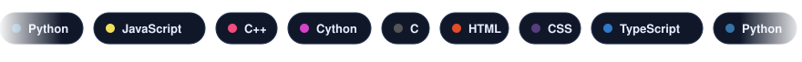

<!-- AUTO-GENERATED by .github/scripts/build.py — edit .github/README.template.md or profile.config.json instead -->

<picture><source media="(prefers-color-scheme: dark)" srcset="https://raw.githubusercontent.com/KoL-200/KoL-200/main/assets/hero-dark.svg?v=21351062"><source media="(prefers-color-scheme: light)" srcset="https://raw.githubusercontent.com/KoL-200/KoL-200/main/assets/hero-light.svg?v=ed524b35"></picture>

<a href="https://github.com/KoL-200">GitHub</a>  ·  <a href="https://x.com/favour32422">X</a>  ·  <a href="mailto:favourkolawole1985@gmail.com">Email</a>

<h2 align="center">About</h2>

- 🔭 Currently working on **[KoL_Portfolio](https://github.com/KoL-200/KoL_Portfolio)**
- 💻 Mostly writing **Python** and **JavaScript**
- 🛠️ Stack: **Python** · **JavaScript** · **SQL** · **Node.js** · **Express.js** · **PostgreSQL** · **Docker** · **CI/CD** · **Jest**
- 💬 Software Engineer
- 📍 Based in **Planet X**
- ⚡ **24** public repos · **1** stars · **7** followers

<picture><source media="(prefers-color-scheme: dark)" srcset="https://raw.githubusercontent.com/KoL-200/KoL-200/main/assets/stats-dark.svg?v=03f81f06"><source media="(prefers-color-scheme: light)" srcset="https://raw.githubusercontent.com/KoL-200/KoL-200/main/assets/stats-light.svg?v=3dbf64f8"></picture>

<h2 align="center">Tech Stack</h2>

<picture><source media="(prefers-color-scheme: dark)" srcset="https://raw.githubusercontent.com/KoL-200/KoL-200/main/assets/stack-dark.svg?v=c6f7062a"><source media="(prefers-color-scheme: light)" srcset="https://raw.githubusercontent.com/KoL-200/KoL-200/main/assets/stack-light.svg?v=36822762"></picture>

<picture><source media="(prefers-color-scheme: dark)" srcset="https://raw.githubusercontent.com/KoL-200/KoL-200/main/assets/heatmap-dark.svg?v=b6d3afc9"><source media="(prefers-color-scheme: light)" srcset="https://raw.githubusercontent.com/KoL-200/KoL-200/main/assets/heatmap-light.svg?v=1c9bdc11"></picture>

<h2 align="center">Featured Projects</h2>

<a href="https://github.com/KoL-200/Logistics_Data_Pipeline"><picture><source media="(prefers-color-scheme: dark)" srcset="https://raw.githubusercontent.com/KoL-200/KoL-200/main/assets/card-0-dark.svg?v=52d8787b"><source media="(prefers-color-scheme: light)" srcset="https://raw.githubusercontent.com/KoL-200/KoL-200/main/assets/card-0-light.svg?v=543cf616"></picture></a> <a href="https://github.com/KoL-200/KoL_Portfolio"><picture><source media="(prefers-color-scheme: dark)" srcset="https://raw.githubusercontent.com/KoL-200/KoL-200/main/assets/card-1-dark.svg?v=3da8cbfd"><source media="(prefers-color-scheme: light)" srcset="https://raw.githubusercontent.com/KoL-200/KoL-200/main/assets/card-1-light.svg?v=2969cd97"></picture></a> <a href="https://github.com/KoL-200/Data_Quality_Project"><picture><source media="(prefers-color-scheme: dark)" srcset="https://raw.githubusercontent.com/KoL-200/KoL-200/main/assets/card-2-dark.svg?v=0721d150"><source media="(prefers-color-scheme: light)" srcset="https://raw.githubusercontent.com/KoL-200/KoL-200/main/assets/card-2-light.svg?v=bc7b786b"></picture></a> <a href="https://github.com/KoL-200/FormSlug"><picture><source media="(prefers-color-scheme: dark)" srcset="https://raw.githubusercontent.com/KoL-200/KoL-200/main/assets/card-3-dark.svg?v=61f8b18d"><source media="(prefers-color-scheme: light)" srcset="https://raw.githubusercontent.com/KoL-200/KoL-200/main/assets/card-3-light.svg?v=53295369"></picture></a> <a href="https://github.com/KoL-200/compass-ai-backend"><picture><source media="(prefers-color-scheme: dark)" srcset="https://raw.githubusercontent.com/KoL-200/KoL-200/main/assets/card-4-dark.svg?v=a1ffab89"><source media="(prefers-color-scheme: light)" srcset="https://raw.githubusercontent.com/KoL-200/KoL-200/main/assets/card-4-light.svg?v=4fff71bb"></picture></a> <a href="https://github.com/KoL-200/health-checker"><picture><source media="(prefers-color-scheme: dark)" srcset="https://raw.githubusercontent.com/KoL-200/KoL-200/main/assets/card-5-dark.svg?v=6f7563e8"><source media="(prefers-color-scheme: light)" srcset="https://raw.githubusercontent.com/KoL-200/KoL-200/main/assets/card-5-light.svg?v=63f06b99"></picture></a>

<h2 align="center">Recently Active</h2>

- [KoL_Portfolio](https://github.com/KoL-200/KoL_Portfolio) — 2026-11-14
- [Data_Quality_Project](https://github.com/KoL-200/Data_Quality_Project) — 2026-11-14
- [FormSlug](https://github.com/KoL-200/FormSlug) — 2026-11-11
- [compass-ai-backend](https://github.com/KoL-200/compass-ai-backend) — 2026-11-03
- [health-checker](https://github.com/KoL-200/health-checker) — 2026-10-09

<picture><source media="(prefers-color-scheme: dark)" srcset="https://raw.githubusercontent.com/KoL-200/KoL-200/main/assets/footer-dark.svg?v=c2d4fe3b"><source media="(prefers-color-scheme: light)" srcset="https://raw.githubusercontent.com/KoL-200/KoL-200/main/assets/footer-light.svg?v=0a188889"></picture>

Auto-updated daily · last updated 2026-11-14

